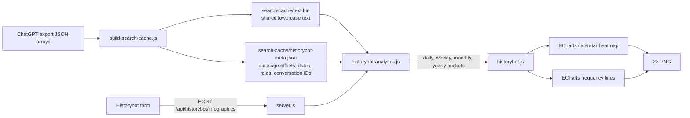

# Historybot Infographics — Implementation Specification

Status: ready for implementation handoff  
Prepared: 2026-07-15  
Target repository: `axgoodhart/Split`  
Target stack: existing Express 5 server + vanilla HTML/CSS/JavaScript

## 1. Objective

Turn the existing Historybot shell into a local, deterministic infographic tool for Alex's ChatGPT history. A user enters one or more topics, chooses whose messages to inspect, and receives:

1. A GitHub-style calendar heatmap showing activity by day.
2. A multi-series frequency graph showing topic activity over time.
3. A high-resolution PNG export of either infographic.

This is analytics, not an LLM feature. It must not call OpenAI, Anthropic, a CDN, or any other external service at runtime. All counting happens locally against the existing ChatGPT export.

The finished experience should be: open Historybot from the existing main-image trigger, enter `historybot`, optionally add comparison topics, select `Both`, click **Create infographic**, switch freely between **Calendar** and **Frequency**, and save the current view as a PNG.

## 2. Repository facts the implementer must preserve

### Current Historybot state

Historybot currently exists only as incomplete markup and styling in `index.html`:

- `#historybot-output` is empty.
- `#topic-input` has no submit/generate path.
- Both origin radios use the duplicate ID `origin`; neither has a label, name, value, or checked state.
- Clicking `#main-image` only toggles `display: none/flex`.
- There is no Historybot server endpoint and no chart dependency.

Do not attempt to wire the charts to the current controls in place. Replace only the Historybot-specific markup/CSS/JS with the structure defined below; preserve the rest of the viewer.

### Data shape and scale

- `Split New Format/conversations-*.json` contains 137 files totaling about 791 MB.
- Each JSON file is an array of conversations, usually 100 conversations per file. A file is not a conversation.
- Current data contains 13,689 conversations and 322,606 active-branch user/assistant messages:
  - 159,168 user messages
  - 163,438 assistant messages
- Current message range is 2023-07-09 through 2026-06-18. Never hardcode those dates; derive them from the cache because future exports will change them.
- The existing `search-cache/text.bin` is about 371 MB and is already loaded into server memory.

The implementation must not create or load a second full copy of the message text. Extend the current search-cache build so Historybot metadata points into the existing `text.bin`.

### Existing uncommitted work

As of this specification, the worktree already contains modifications to `About.md`, `index.html`, and `server.js`, plus untracked `build-search-cache.js` and `search-cache/`. These changes belong to Alex. Do not reset, discard, or overwrite them. `search-cache/` is generated data and must never be committed.

## 3. Locked product decisions

These decisions remove ambiguity for the implementation agent.

| Area | Required behavior |
|---|---|
| Topic count | Zero to five topic phrases. Zero means “All activity.” |
| Comparison | Each topic becomes an independent line series. A message matching two topics counts in both series. |
| Role filter | One segmented control: `Both` (default), `You`, or `Assistant`. |
| Search meaning | Case-insensitive literal substring matching. No regex, stemming, synonyms, semantic search, or Boolean syntax. Punctuation and internal whitespace remain significant. |
| Default measure | Matching messages: a message contributes at most one count to a topic, even if the phrase occurs repeatedly. |
| Other measures | Mentions: every non-overlapping literal occurrence. Conversations: unique conversations containing a match in the displayed bucket. |
| Date source | `message.create_time`; fall back to the parent conversation's `create_time`; exclude only if both are absent. |
| Branches | Count only messages on the visible/current branch, using the same traversal semantics as `getMessagesInOrder()` in `index.html`. Hidden regenerated branches must not inflate counts. |
| Roles indexed | `user` and `assistant` only. Exclude system, tool, and other roles. |
| Text indexed | Plain string parts and audio-transcription text. Exclude filenames, image asset pointers, message metadata, and conversation titles from Historybot counts. |
| Time zone | `process.env.HISTORYBOT_TIMEZONE || 'America/New_York'`; store the resulting local `YYYY-MM-DD` in metadata. |
| Week boundary | Sunday through Saturday, matching the calendar layout. |
| Date range | All history by default. Custom start/end are inclusive. |
| Calendar | One selected topic and one selected year at a time. If multiple topics exist, a topic selector appears. Default year is the latest year in the applied range. |
| Frequency | All topic series appear together. Granularity choices: Auto, Day, Week, Month, Year. |
| Auto granularity | Up to 120 days: day; 121–730 days: week; over 730 days: month. |
| Runtime model | Local, single-user, synchronous analytics over the in-memory cache. No database, workers, queues, authentication, or scaling infrastructure. |
| Export | Save the current chart as a 2× PNG with its title, subtitle, legend, date range, and dark background included in the image. |

## 4. Technical choice: Apache ECharts

Use Apache ECharts `6.1.0`, pinned exactly in `package.json` and `package-lock.json`.

Why it fits this repository:

- One browser library handles both line charts and native calendar-coordinate heatmaps.
- It works with the existing vanilla-JavaScript, no-build setup.
- It supports canvas PNG export, legends, tooltips, zoom, ARIA descriptions, and responsive resizing.
- It is Apache-2.0 licensed.

Install with `npm install --save-exact echarts@6.1.0`. Serve the local file explicitly from Express; do not use a CDN:

```js
app.use(
  '/vendor/echarts',
  express.static(path.join(__dirname, 'node_modules/echarts/dist'))
);
```

Load `/vendor/echarts/echarts.min.js` before `historybot.js`.

Primary references:

- https://github.com/apache/echarts/blob/master/package.json
- https://echarts.apache.org/en/option.html
- https://echarts.apache.org/handbook/en/concepts/chart-size/
- https://echarts.apache.org/handbook/en/concepts/dataset/

## 5. Target architecture



One query returns all three measures and all four granularities. Changing chart type, measure, granularity, calendar topic, or calendar year is then instant and does not re-query the server. Only changing topics, role, or date range requires a new request.

## 6. File-by-file change map

### Add `.gitignore`

Add exactly this generated directory if it is not already ignored:

```gitignore
search-cache/
```

Do not ignore the source scripts or tests.

### Modify `build-search-cache.js`

Upgrade the cache builder to produce a versioned Historybot metadata file while preserving existing file-level search behavior.

Required additions:

- `CACHE_SCHEMA_VERSION = 2`
- `HISTORYBOT_META_PATH = search-cache/historybot-meta.json`
- Active-branch traversal equivalent to the browser's `getMessagesInOrder()`.
- Historybot text extraction equivalent to the rules in section 3.
- Absolute byte offsets into the same `text.bin` used by ordinary search.
- Cache freshness checks for schema version, Historybot metadata presence, configured time zone, source filenames, file sizes, and source mtimes.
- Temporary-file writes followed by a metadata-last swap. An interrupted swap must be detected as stale and rebuilt before the cache is loaded.
- Export pure helper functions needed by tests.

Keep all text needed for ordinary search in each file's search block. For each active user/assistant message, place the countable message text contiguously within that block and record its exact absolute byte range. Extra text used only by ordinary search may be written outside that recorded range.

The builder must iterate every conversation in every JSON array. Do not use only the first conversation's timestamp, title, or mapping for Historybot.

### Add `historybot-analytics.js`

This CommonJS module owns all request validation and counting logic. It must not know about Express or the DOM.

Export at least:

```js
module.exports = {
  validateInfographicRequest,
  queryInfographics,
  getBucketStart,
  enumerateBucketStarts,
  chooseAutoGranularity,
  countOccurrences,
};
```

The module accepts the loaded `text.bin` Buffer and parsed Historybot metadata. Keeping this module pure makes nearly all important behavior unit-testable without starting the server.

### Modify `server.js`

- Load Historybot metadata alongside the existing search cache.
- Add the explicit local ECharts static route.
- Add `GET /api/historybot/status`.
- Add `POST /api/historybot/infographics`.
- Keep every existing route and response contract unchanged.
- Return structured JSON errors; never return raw stack traces to the client.
- Do not add an LLM SDK or outbound request.

### Add `historybot.css`

Move only Historybot-specific presentation into this stylesheet. Leave unrelated inline CSS alone. Remove the old Historybot-specific declarations from `index.html` with a targeted patch after the new stylesheet is linked.

### Add `historybot.js`

Wrap the entire client controller in an IIFE so it adds no accidental globals. It owns the form, network call, view state, chart options, resize handling, errors, and export.

### Modify `index.html`

- Link `historybot.css` in `<head>`.
- Replace only the current `#historybot` block with the semantic markup in section 9.
- Load ECharts and `historybot.js` near the end of `<body>`.
- Remove only the old main-image Historybot toggle; initialization moves to `historybot.js`.
- Preserve the main-image trigger and every unrelated viewer behavior.

### Modify `package.json` and `package-lock.json`

- Pin `echarts` to `6.1.0`.
- Replace the placeholder test script with a focused script:

```json
"test:historybot": "node --test test/historybot-*.test.js"
```

Do not introduce a bundler, framework, TypeScript, or test framework.

### Add tests

```text
test/
  fixtures/
    historybot-branching-conversation.json
  historybot-index.test.js
  historybot-analytics.test.js
```

Use Node's built-in `node:test` and `node:assert/strict`.

### Update `About.md`

Correct the existing stale port references while documenting:

- how Historybot counting works,
- the generated cache files,
- the local ECharts dependency,
- the fixed/default time zone,
- the focused test command.

Do not rewrite unrelated prose.

## 7. Shared cache design

### `search-cache/meta.json`

Preserve the existing file metadata and add the top-level cache schema version. Ordinary search still uses each file's `offset` and `byteLength` exactly as it does now.

### `search-cache/historybot-meta.json`

Use this shape:

```json
{
  "schemaVersion": 1,
  "cacheSchemaVersion": 2,
  "builtAt": 1784156400000,
  "timezone": "America/New_York",
  "sourceRange": {
    "start": "2023-07-09",
    "end": "2026-06-18"
  },
  "recordLayout": [
    "offset",
    "byteLength",
    "date",
    "role",
    "conversationOrdinal"
  ],
  "roles": {
    "u": "user",
    "a": "assistant"
  },
  "stats": {
    "conversations": 13689,
    "messages": 322606,
    "timestampFallbacks": 0,
    "undatedMessages": 0
  },
  "records": [
    [1234, 87, "2026-07-14", "u", 42],
    [1322, 245, "2026-07-14", "a", 42]
  ]
}
```

The example values are illustrative; calculate them during every build.

Compact tuple records are intentional. At the current 322,606-message scale, object-per-message metadata wastes substantial memory. Add named index constants in code so tuple positions are never represented by unexplained numeric literals:

```js
const RECORD_OFFSET = 0;
const RECORD_LENGTH = 1;
const RECORD_DATE = 2;
const RECORD_ROLE = 3;
const RECORD_CONVERSATION = 4;
```

### Message traversal

For a conversation with a valid `current_node`, walk parent pointers from `current_node` to the root, reject cycles with a `Set`, retain displayable nodes, then reverse the result. This is the currently visible branch.

If `current_node` is unavailable, use the existing browser fallback traversal. The fixture must cover both paths.

### Countable text

For each active user/assistant message:

1. Require a supported `content_type`: absent, `text`, or `multimodal_text`.
2. Include string items from `content.parts`.
3. Include `.text` from `audio_transcription` parts.
4. Join included parts with a newline.
5. Lowercase once during cache construction.
6. Skip the record if the resulting text is blank.
7. Do not include `asset_pointer`, attachment labels, titles, IDs, metadata, or URLs synthesized from non-text parts.

The topic needle is trimmed and lowercased in the same way. Matching is byte-level UTF-8 literal substring search over the recorded slice.

### Timestamp conversion

Use `Intl.DateTimeFormat('en-CA', { timeZone, year: 'numeric', month: '2-digit', day: '2-digit' })`, but do not assume every Node runtime emits `YYYY-MM-DD` from `format()`. Prefer `formatToParts()` and assemble the date explicitly.

Store only the local date needed by these charts. This avoids repeated time-zone conversion on every query.

### Atomicity and freshness

Build `text.bin.tmp`, `meta.json.tmp`, and `historybot-meta.json.tmp`. Close all file descriptors, parse both temporary JSON files, and verify that every recorded byte range fits inside the temporary text Buffer before replacing live files. Rename `text.bin` first and both metadata files last; the metadata `builtAt`, source fingerprint, and schema fields are the commit markers. `loadCache()` must run only after `ensureCache()` completes successfully. If the process is interrupted between renames, the metadata/text fingerprint mismatch is stale on the next startup and forces a complete rebuild before anything is loaded. Remove abandoned `.tmp` files at the start of that rebuild.

The cache is stale if any of these differ:

- cache schema version,
- Historybot metadata schema version,
- configured Historybot time zone,
- source file count,
- source filename,
- source size,
- source mtime newer than `builtAt`.

On stale or missing cache, rebuild at normal server startup using the existing `ensureCache()` flow. This may delay first startup after the feature lands, which is acceptable for this local single-user application. Subsequent starts load the cache.

## 8. Analytics semantics and algorithm

### Measures

For each topic and bucket:

- `messages`: number of matching messages; one maximum per message/topic.
- `mentions`: number of non-overlapping literal occurrences across matching messages.
- `conversations`: number of unique `conversationOrdinal` values with at least one match.

For the synthetic `All activity` series, every eligible message matches once. Set `mentions` equal to `messages`; the UI disables the Mentions measure and explains why.

### Date buckets

Return four complete, zero-filled bucket arrays for each series:

- `day`: every local date, `YYYY-MM-DD`.
- `week`: the Sunday date starting that week.
- `month`: the first day of the month.
- `year`: January 1 of the year.

Use UTC date arithmetic on already-local date strings to avoid daylight-saving jumps while enumerating date-only values. Date-range endpoints are inclusive.

### Conversation uniqueness

Maintain temporary `Set`s per series and per bucket for conversation counts. Also maintain one total-conversation Set per series. Convert Set sizes to numeric values before forming the response; no Sets or conversation IDs leave the server.

### Counting pseudocode

```text
validate and normalize request
resolve applied date range against cache source bounds
create one accumulator per topic, or synthetic All activity

for each compact message record:
    skip if role is not selected
    skip if date is outside applied range
    obtain the exact Buffer slice using offset + byteLength

    for each topic accumulator:
        occurrences = 1 for All activity
        otherwise count non-overlapping Buffer occurrences of topic needle
        continue when occurrences is zero

        increment total messages by 1
        increment total mentions by occurrences
        add conversation ordinal to total conversation Set

        for day, week, month, and year:
            derive bucket start from record date
            increment bucket messages by 1
            increment bucket mentions by occurrences
            add conversation ordinal to that bucket's Set

materialize all conversation Set sizes
zero-fill all four bucket sequences over the applied range
return response without message text or conversation IDs
```

Use `Buffer.indexOf(needle, fromIndex)` in a loop for mentions and advance by `needle.length`, which defines non-overlapping behavior. An empty needle is never passed to this function.

## 9. HTTP contract

### `GET /api/historybot/status`

Purpose: let the client distinguish an unavailable cache from a query failure and initialize date controls.

Success, `200`:

```json
{
  "ready": true,
  "timezone": "America/New_York",
  "cacheBuiltAt": "2026-07-15T20:30:00.000Z",
  "sourceRange": {
    "start": "2023-07-09",
    "end": "2026-06-18"
  },
  "stats": {
    "conversations": 13689,
    "messages": 322606,
    "undatedMessages": 0
  }
}
```

Unavailable cache, `503`:

```json
{
  "ready": false,
  "error": {
    "code": "HISTORYBOT_CACHE_UNAVAILABLE",
    "message": "Historybot's local index is unavailable. Restart Split to rebuild it."
  }
}
```

### `POST /api/historybot/infographics`

Request:

```json
{
  "topics": ["historybot", "calendar plot"],
  "roles": ["user", "assistant"],
  "dateRange": {
    "start": null,
    "end": null
  }
}
```

Validation rules:

- `topics` must be an array with no more than five entries.
- Trim topics, remove blank entries, and deduplicate case-insensitively while preserving the first label's casing.
- Each retained topic must be 1–80 characters after trimming.
- Zero retained topics is valid and produces `All activity`.
- `roles` must resolve to `['user']`, `['assistant']`, or both; no other role is accepted.
- `dateRange.start` and `dateRange.end` must either both be `null`/absent or both be valid `YYYY-MM-DD` strings.
- Start must not be after end.
- Reject a requested span longer than 20 years to prevent an accidental enormous zero-filled response.

Successful response, `200`:

```json
{
  "meta": {
    "timezone": "America/New_York",
    "cacheBuiltAt": "2026-07-15T20:30:00.000Z",
    "generatedAt": "2026-07-15T20:34:12.000Z",
    "sourceRange": {
      "start": "2023-07-09",
      "end": "2026-06-18"
    },
    "appliedRange": {
      "start": "2023-07-09",
      "end": "2026-06-18"
    },
    "recommendedGranularity": "month",
    "eligibleMessages": 322606,
    "excludedUndatedMessages": 0,
    "durationMs": 184
  },
  "query": {
    "roles": ["user", "assistant"],
    "isAllActivity": false,
    "topics": [
      {
        "id": "topic-1",
        "label": "historybot"
      },
      {
        "id": "topic-2",
        "label": "calendar plot"
      }
    ]
  },
  "series": [
    {
      "id": "topic-1",
      "label": "historybot",
      "totals": {
        "messages": 24,
        "mentions": 31,
        "conversations": 8
      },
      "buckets": {
        "day": [
          {
            "start": "2023-07-09",
            "messages": 0,
            "mentions": 0,
            "conversations": 0
          }
        ],
        "week": [],
        "month": [],
        "year": []
      }
    }
  ]
}
```

All bucket arrays in a real response must be populated and zero-filled; the abbreviated arrays above only show the schema.

`meta.appliedRange` is either the intersected `{ "start", "end" }` object above or `null` when a custom request has no overlap with the source data. In the `null` case, return one zero-total series per normalized topic (or All activity), with all four bucket arrays empty and `recommendedGranularity: null`.

Structured error, `400`:

```json
{
  "error": {
    "code": "INVALID_TOPICS",
    "message": "Use no more than five topic phrases."
  }
}
```

Use stable codes for invalid topics, invalid roles, invalid date range, unavailable cache, and query failure. The UI displays the message and keeps the user's form values.

## 10. Historybot markup and interaction

The exact DOM may vary slightly, but these IDs and semantics are required because they define the client contract:

```html
<section id="historybot" hidden aria-labelledby="historybot-title">
  <header class="historybot-header">
    <div>
      <h2 id="historybot-title">Historybot</h2>
      <p id="historybot-status">Turn your conversation history into a picture.</p>
    </div>
    <button id="historybot-close" type="button" aria-label="Close Historybot">×</button>
  </header>

  <form id="historybot-form">
    <fieldset>
      <legend>Topics</legend>
      <div id="historybot-topic-list"></div>
      <button id="historybot-add-topic" type="button">Compare another topic</button>
      <p class="historybot-hint">Leave the first topic blank to chart all activity.</p>
    </fieldset>

    <fieldset>
      <legend>Messages from</legend>
      <!-- One properly named radio group: both / user / assistant -->
    </fieldset>

    <details id="historybot-options">
      <summary>Date range</summary>
      <!-- All history (default) / Custom; custom reveals two labelled date inputs -->
    </details>

    <button id="historybot-generate" type="submit">Create infographic</button>
  </form>

  <section id="historybot-output" aria-live="polite" aria-busy="false">
    <div class="historybot-toolbar">
      <div role="tablist" aria-label="Infographic type">
        <button id="historybot-tab-calendar" role="tab" type="button">Calendar</button>
        <button id="historybot-tab-frequency" role="tab" type="button">Frequency</button>
      </div>
      <label>Measure <select id="historybot-measure"></select></label>
      <label id="historybot-granularity-wrap">Interval <select id="historybot-granularity"></select></label>
      <label id="historybot-calendar-topic-wrap">Topic <select id="historybot-calendar-topic"></select></label>
      <label id="historybot-calendar-year-wrap">Year <select id="historybot-calendar-year"></select></label>
      <button id="historybot-save-png" type="button" disabled>Save PNG</button>
    </div>
    <p id="historybot-summary"></p>
    <div id="historybot-chart" role="img" aria-label="Historybot infographic"></div>
    <div id="historybot-empty"></div>
    <div id="historybot-error" role="alert"></div>
  </section>
</section>
```

Every input needs a visible `<label>` or `<legend>`. Every icon-only button needs an `aria-label`. Touch targets must be at least 44×44 CSS pixels.

### Topic rows

- Render one row initially.
- Use unique IDs such as `historybot-topic-1`.
- `Compare another topic` adds a row until five exist, then becomes disabled.
- Rows after the first have a labelled remove button.
- Removing a row does not auto-submit.
- Pressing Enter in a topic field submits the form.
- Preserve the user's entered casing for labels and titles.

### Opening and closing

- Clicking the existing `#main-image` toggles the panel.
- The close button closes it.
- Escape closes it when focus is inside the panel.
- Opening returns focus to the first topic field on first use; reopening after a chart keeps the current state and resizes the chart.
- The panel is modeless; do not block the rest of Split and do not use `<dialog>`.
- Use the `hidden` attribute and an open class rather than inspecting inline `style.display` strings.

### Form submission

- Disable **Create infographic** while a request is in flight.
- Set `aria-busy="true"` on output.
- Show `Counting matches…` rather than a generic spinner-only state.
- Use an `AbortController` to ignore an older client request if a newer submission starts.
- On success, retain the selected view/measure where possible and render.
- On error, restore the button, preserve the form, and show the server's actionable message.

### Empty state

Before the first query:

> Add a topic—or leave it blank for all activity—then create an infographic.

When all series totals are zero:

> No matches in this range. Try a broader phrase, another message source, or all history.

Do not initialize an empty chart behind either message.

## 11. Visual specification

The visual direction is a precise “personal archive instrument”: dark, dense, and editorial rather than a generic glowing AI dashboard. Preserve the surrounding app's glassy character, but make the plotting surface flat and legible.

### Panel

- Remove the current `rotateX(8deg)` from Historybot; perspective distortion is unacceptable for charts.
- Desktop size: `width: min(1120px, calc(100vw - 2rem))` and `height: min(760px, calc(100vh - 2rem))`.
- Position one rem from the right and bottom.
- Minimum useful height: 520px.
- Output scrolls internally when needed; the chart itself receives an explicit minimum height.
- Use a subtle blue-green-tinted charcoal, not pure black.
- Avoid glow, glass cards nested inside cards, decorative gradients, and rounded rectangles around every control.

### Chart palette

Use a fixed topic order so a topic retains its color between views:

```js
const TOPIC_COLORS = [
  '#3B73E8', // cobalt
  '#C18B13', // brass
  '#18A6A8', // teal
  '#D85F74', // rose
  '#8A70D6', // violet
];
```

Use different dash patterns for the fourth and fifth frequency series so color is not the only distinction.

Calendar ramp:

```js
const CALENDAR_COLORS = [
  '#182129', // zero / empty cell
  '#133222',
  '#14532D',
  '#1F7A3D',
  '#5BD46D',
];
```

Supporting colors:

- chart surface: `#0C1116`
- primary text: `#D8E2EA`
- muted text: `#8E9AA5`
- grid lines: `#283139`
- focus ring: `#78A7FF`

CSS may express equivalent surfaces in OKLCH, but feed the stable hex values above to ECharts.

### Frequency chart

- ECharts line series on a time x-axis and numeric y-axis.
- Line width: 3px.
- `smooth: 0.2`; do not use heavy smoothing that hides spikes.
- `showSymbol: false`; reveal a symbol on emphasis/tooltip.
- Thin horizontal grid lines only.
- No filled area under the lines.
- Legend at top; clicking a legend item may hide/show a series.
- Tooltip uses a crosshair and reports exact bucket label plus every visible series value.
- Y-axis starts at zero and uses integer labels.
- Add inside zoom plus a slim visible slider only when the selected bucket list exceeds 120 points.
- Auto granularity uses `meta.recommendedGranularity`.
- Chart title is the topic comparison (`historybot vs calendar plot`) or `All Historybot activity`.
- Subtitle states measure, role, interval, date range, and time zone.

### Calendar heatmap

- Use ECharts `calendar` coordinate system with a `heatmap` series.
- Sunday is the first row.
- Month labels sit above the cells; short weekday labels sit at left.
- Show one year or selected partial-year range at a time.
- Empty days use the base charcoal cell; increasing activity moves through the green ramp.
- Compute the visual scale maximum as the 95th percentile of nonzero visible values, minimum 1. Values above the cap use the brightest color, while tooltips always show the exact number. This prevents one extreme day from making every other active day look empty.
- Tooltip reports full date, selected topic, exact measure value, and the other two measure values for context.
- If multiple topics exist, the calendar topic selector is visible; otherwise hide its wrapper.
- Calendar title is `Historybot activity: <topic>`.

### Responsive and input behavior

- At narrow widths, the panel uses `inset: .5rem`, auto width, and `height: calc(100vh - 1rem)`.
- Controls become one column; no critical control is hidden.
- Detect coarse pointer input and retain 44px targets.
- Never require hover for a value or action.
- Use a `ResizeObserver` on the chart container and call `chart.resize()` when the panel, window, or control layout changes.
- Honor `prefers-reduced-motion`; set ECharts `animation: false` and remove panel transition when requested.

## 12. Client state and render responsibilities

Use one explicit state object:

```js
const state = {
  response: null,
  view: 'frequency',
  measure: 'messages',
  granularity: 'auto',
  calendarTopicId: null,
  calendarYear: null,
  chart: null,
  requestController: null,
};
```

Required client functions:

```text
initHistorybot()
openHistorybot()
closeHistorybot()
addTopicRow(value = '')
removeTopicRow(row)
collectRequest()
submitHistorybot(event)
setHistorybotBusy(isBusy)
renderHistorybot()
renderFrequencyChart()
renderCalendarChart()
buildFrequencyOption(...)
buildCalendarOption(...)
updateControlVisibility()
renderEmptyState(message)
renderError(message)
saveCurrentChartPng()
```

Rules:

- Initialize ECharts only after the panel is visible and has measurable dimensions.
- Reuse one ECharts instance and call `clear()` before switching chart types.
- If the chart DOM node is ever replaced, call `dispose()` first.
- Metric/granularity/topic/year controls call `renderHistorybot()` without fetching.
- Escape any user-entered label before using an HTML tooltip formatter. Prefer text-only formatter output where practical.
- Keep chart title/subtitle inside the ECharts option so PNG export is self-explanatory.
- Enable ECharts ARIA descriptions and update the chart container's `aria-label` with a concise text summary.

### PNG export

Use:

```js
chart.getDataURL({
  type: 'png',
  pixelRatio: 2,
  backgroundColor: '#0C1116',
});
```

Download through a temporary anchor and then remove it. Filename format:

```text
historybot-<view>-<topic-or-comparison>-<start>-to-<end>.png
```

Sanitize the topic segment to lowercase ASCII letters/numbers/hyphens, collapse repeated hyphens, and cap it at 60 characters. Disable **Save PNG** until a nonempty chart has rendered.

## 13. Server behavior details

- `GET /api/historybot/status` reads already loaded metadata; it does not touch source JSON.
- `POST /api/historybot/infographics` validates before scanning.
- Measure duration with `performance.now()` from `node:perf_hooks` or `process.hrtime.bigint()`.
- Do not log topic text, message text, or response data. One concise duration/count line is acceptable in development but not required.
- Do not return matching snippets or message IDs in v1.
- Intersect custom dates with the source range. If there is no overlap, return `meta.appliedRange: null`, `meta.recommendedGranularity: null`, zero totals, and empty bucket arrays with HTTP 200 rather than a server error.
- The server must never mutate the loaded Buffer or metadata during a query.
- No result cache is required for v1; the single response already supports instant client-side view changes.

## 14. Automated test specification

The implementation handoff should explicitly authorize only the tests below; it should not authorize starting the server.

### Index tests

1. Iterates every conversation inside an array file.
2. Follows `current_node` parents and excludes a regenerated sibling branch.
3. Reverses the parent walk into display order.
4. Rejects a parent cycle without hanging.
5. Uses fallback traversal when `current_node` is missing.
6. Includes string text and audio transcription.
7. Excludes asset pointers, attachment labels, titles, system messages, and tool messages.
8. Uses message timestamp and conversation timestamp fallback.
9. Excludes a message with no usable date and increments the undated count.
10. Produces a record whose Buffer slice exactly equals the expected lowercased countable text.
11. Assigns one conversation ordinal to all messages in that conversation and different ordinals to different conversations.
12. Marks cache stale for schema, timezone, source size, filename, count, or mtime changes.

### Analytics tests

1. Case-insensitive literal matching.
2. Substring behavior is explicit: `art` matches `cartography`.
3. One message with three occurrences yields `messages: 1`, `mentions: 3`, `conversations: 1`.
4. Non-overlapping occurrence behavior is stable.
5. User-only, assistant-only, and both filters.
6. Inclusive start and end dates.
7. Sunday week starts across a month and year boundary.
8. Day enumeration includes leap day.
9. Month and year bucket starts.
10. Zero filling before, between, and after matches.
11. Conversation uniqueness within each bucket and across totals.
12. A message matching two topics increments both series independently.
13. Blank topics produce All activity.
14. Duplicate topics collapse case-insensitively.
15. More than five topics, an 81-character topic, invalid role, partial date range, reversed range, and over-20-year range each return the expected validation code.
16. Auto granularity boundaries at 120 and 730 days.
17. Response contains no message text, offsets, or conversation ordinals.

### Authorized commands for the implementation run

```bash
node --check server.js
node --check build-search-cache.js
node --check historybot-analytics.js
node --check historybot.js
npm run test:historybot
```

Do not start `node server.js` during the implementation run. Alex performs the visual walkthrough after restarting Split himself.

## 15. Manual acceptance walkthrough for Alex

1. Restart Split normally. The first restart may rebuild the upgraded cache once.
2. Click the existing main image. Historybot opens without perspective distortion.
3. Leave Topic blank, keep Both selected, and create an infographic. Frequency shows overall message activity across the data range.
4. Switch measure between Matching messages and Conversations. The chart changes instantly without a new loading state.
5. Switch intervals. Auto selects Month for the current multi-year export.
6. Switch to Calendar. The latest available year is selected and active days appear in the green heat scale.
7. Enter a topic known to exist. Calendar and frequency totals become topic-specific.
8. Choose You, then Assistant. Results differ and the subtitle clearly names the selected source.
9. Add two comparison topics. Frequency shows three labelled, distinct series; Calendar offers a topic selector.
10. Choose a custom inclusive date range. Titles, buckets, year selector, and tooltips stay inside it.
11. Search for a nonsense phrase. Historybot shows the helpful empty state and no blank canvas.
12. Resize the window and reopen Historybot. The chart fills its container and remains sharp.
13. Use keyboard Tab/Shift+Tab through every control. Focus rings are visible; Enter submits; Escape closes.
14. Save each view as PNG. The files are twice the on-screen pixel density and remain understandable without the app around them.
15. Use Split's existing conversation list and Boolean search. Their behavior and speed are unchanged.

## 16. Acceptance criteria / definition of done

The feature is complete only when all statements are true:

- One to five literal topics can be charted; blank means All activity.
- Both role radios are replaced by one valid, labelled control with Both/You/Assistant.
- Calendar and frequency views use the same server result and switch without refetching.
- Matching messages, mentions, and conversations are all correct and switch without refetching.
- Active branches, message timestamps, role filters, date boundaries, and unique-conversation counts match the test fixtures.
- Every returned bucket sequence is chronological and zero-filled.
- Calendar year/topic and frequency interval controls appear only where relevant.
- No-match, loading, unavailable-cache, validation-error, and successful states are visibly distinct.
- A 2× PNG export includes context, not just an unlabeled plot.
- Charts resize after opening, panel resizing, and viewport changes.
- There is no second full-text corpus in memory or on disk.
- Existing list/search routes and UI remain operational.
- `search-cache/` is ignored by Git and no generated data is committed.
- The focused Historybot tests pass when authorized.
- Only intended files are staged, committed, and pushed.

## 17. Performance and reliability guardrails

- Current-scale queries should complete within roughly 2 seconds for one topic and 5 seconds for five topics on Alex's machine. Treat these as investigation thresholds, not reasons to add infrastructure preemptively.
- The all-history, five-topic response should remain below 2 MB.
- `historybot-meta.json` should remain compact tuple metadata and should not approach the size of `text.bin`.
- No query reparses the 791 MB source JSON.
- No query writes files.
- Cache generation is the only operation that reads all source JSON, and it occurs only when freshness checks fail.
- Use one cache build at a time. A normal build error before the swap leaves live files untouched; an interrupted swap is detected and rebuilt on the next startup rather than loaded as valid.
- Keep functions small and pure around traversal, validation, bucketing, and counting; these are the high-risk correctness points.

## 18. Explicit non-goals for v1

Do not add any of the following while implementing this specification:

- LLM-written narratives or chart recommendations
- semantic search, stemming, fuzzy search, regex, or Boolean topic grammar
- click-through from a chart point into matching messages
- pie, bar, word cloud, network, or map charts
- CSV/PDF export or clipboard image copying
- saved dashboards or query history
- live watching/reindexing while the server remains open
- database or SQLite migration
- authentication, permissions, multi-user separation, rate limits, workers, queues, or telemetry
- framework/bundler migration

These can be added later without changing the v1 response's core series/bucket structure.

## 19. Recommended implementation order and checkpoints

1. **Protect the current work.** Create `feature/historybot-infographics`, add `search-cache/` to `.gitignore`, and make a safety checkpoint of the existing tracked work plus `build-search-cache.js`, excluding generated cache/data. Push the checkpoint.
2. **Write fixtures and pure tests.** Add the branch/timestamp/content fixtures and analytics expectations before cache changes.
3. **Upgrade the shared cache.** Produce Historybot tuple metadata referencing `text.bin`; make freshness and atomic writes pass tests.
4. **Add analytics and HTTP contracts.** Implement validation, buckets, measures, status, and query endpoint. Commit and push the backend slice.
5. **Install pinned ECharts.** Add the explicit local route and script order.
6. **Build the semantic Historybot panel.** Make targeted `index.html` edits plus isolated CSS.
7. **Build the client controller and chart options.** Complete every state and PNG export.
8. **Update documentation and run only the authorized checks.** Do not start the server.
9. **Review `git diff` and stage only feature files.** Commit the frontend/docs slice and push the feature branch.
10. **Hand back to Alex for the manual walkthrough.** Report any acceptance item that could not be verified without running the server.

## 20. Ready-to-paste handoff prompt

Use this prompt with the implementation agent:

> Implement `HISTORYBOT_INFOGRAPHICS_SPEC.md` completely in `/Users/alex/Documents/Cufolio/Split`. Treat every locked decision, API shape, test case, acceptance criterion, and non-goal as required. Preserve all current uncommitted work; never reset or rewrite unrelated files. First create and push a `feature/historybot-infographics` safety checkpoint, excluding generated data and `search-cache/`. You are authorized to install the exact local dependency `echarts@6.1.0`, create/edit the listed source and test files, run only the five commands in “Authorized commands for the implementation run,” and commit/push the feature work. Do not start a server. Use targeted patches, keep the existing viewer/search behavior intact, and stop only after the code, focused tests, documentation, Git commits, and push are complete or a concrete blocker is documented.
